# Omni OS

The Omni Operating System as software: a multi-company operating platform for Omni portfolio companies — **North Star, Flight Plan, Crew and Mission Control** — and a portfolio view for Omni's investment and operating team. *Begin with the buyer. Focus on less. Execute every week.*

It covers the Blueprint dashboard, the Monday KPI scorecard (CEO-approved, sent to Omni), the weekly ELT meeting, the monthly flash and Board check-in, the quarterly Board pack, the 8-stage quarterly offsite and annual reset, employee and customer listening, the first 100 days, the governance calendar, and per-company branding on top of Omni's identity.

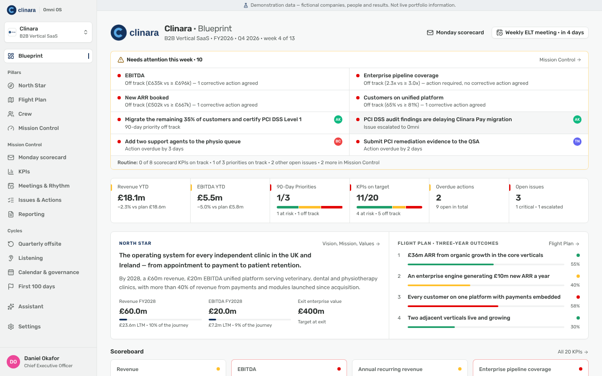

> **Demonstration data:** the seed creates three fictional companies — Clinara (B2B vertical SaaS, own branding), Kestrel Compliance Services (tech-enabled services, own branding) and Ashworth Analytics (38 days after completion, mid first-100-days, Omni default branding). They are flagged `is_demo` and every screen showing them carries a banner.

## Prerequisites
- Node 20+ (tested on 22), npm
- Docker (for local Supabase)

## Run locally
```bash
npm install
cp .env.example .env.local          # then paste keys from `npx supabase status`
npx supabase start -x realtime,storage-api,imgproxy,mailpit,studio,edge-runtime,logflare,vector,supavisor,postgres-meta
npm run db:reset                    # migrations + demo seed
npm run dev                         # http://localhost:3000
```
Sign in with any demo account (password `OmniDemo!2026`) — the login page lists them in demo mode:

| Account | Role | Sees |
|---|---|---|
| priya@omni.demo | Omni operating partner | All three companies + portfolio, Monday scorecards, confidential notes |
| tom@omni.demo | Omni investment director | Clinara only (explicit assignment) |
| sam@omni.demo | Platform administrator | Everything + administration |
| daniel@clinara.demo / sarah@kestrel.demo / imogen@ashworth.demo | CEO | Own company; approves the Monday scorecard; branding and settings |
| marcus@clinara.demo, aisha@…, nadia@kestrel.demo, raj@ashworth.demo … | Executive | Own company |
| helen@clinara.demo | Chair / Board observer (read-only) | Own company, no edits, no Monday scorecards |

## Agents
Five agents (Execution, CEO, Commercial, M&A sourcing, M&A Integration) run in a separate worker process. See `docs/agents.md` and `docs/integration.md`.
```bash
npm run agents:worker        # long-running worker (or `npm run agents:tick` for one pass)
npm run agents:eval          # scenario checks + per-company operating-quality report
```
In the demo, Clinara's Execution Agent follows up automatically and its Commercial Agent works a fictional sandbox CRM; Kestrel's agents are approval-gated and its M&A Agent searches a fictional dataset; Ashworth's agents are off. Clinara's **M&A Integration Agent** has three previous acquisitions' documents to build a playbook from — the 13-step walkthrough is in `docs/integration.md`. Open **Agents → Agent Control Centre** as a CEO, and **Agent requests** as an action owner.

## Tests
```bash
npm run lint && npm run typecheck
npm test                     # unit + tenant-isolation + agent integration tests (reseeds local DB)
PLAYWRIGHT_CHROMIUM_PATH=/opt/pw-browsers/chromium npm run test:e2e   # full workflow in a browser (reseeds)
```

## Deploying (Vercel + Supabase)
1. Create a Supabase project; run `npx supabase link` then `npx supabase db push` to apply `supabase/migrations`.
2. In Vercel set `NEXT_PUBLIC_SUPABASE_URL`, `NEXT_PUBLIC_SUPABASE_ANON_KEY`, `SUPABASE_SERVICE_ROLE_KEY` (server-only), `NEXT_PUBLIC_DEMO_MODE=false` for production, `SUPABASE_JWT_SECRET` and `AGENTS_ENCRYPTION_KEY` (agent worker, run as a separate process), and optionally `ANTHROPIC_API_KEY` (assistant narrative, and AI playbook/plan generation where a company allows external AI) and `RESEND_API_KEY` + `EMAIL_FROM` (Monday scorecard email; without them the scorecard is delivered in-app and logged as "email not configured").
3. Do **not** seed demo data into production. (`npm run db:seed` refuses non-local URLs unless `SEED_ALLOW_REMOTE=true`.)

Deployment has not been performed from this environment (no Vercel/Supabase cloud credentials). See `docs/decisions.md`.

Branding needs no configuration: Omni's identity is the default, and each company sets its own logo and colours in **Settings → Appearance & Branding**.

## Screenshots
| | |
|---|---|
| 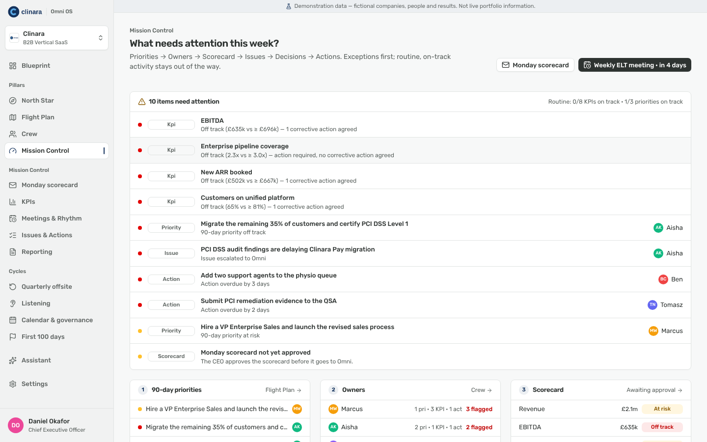 | 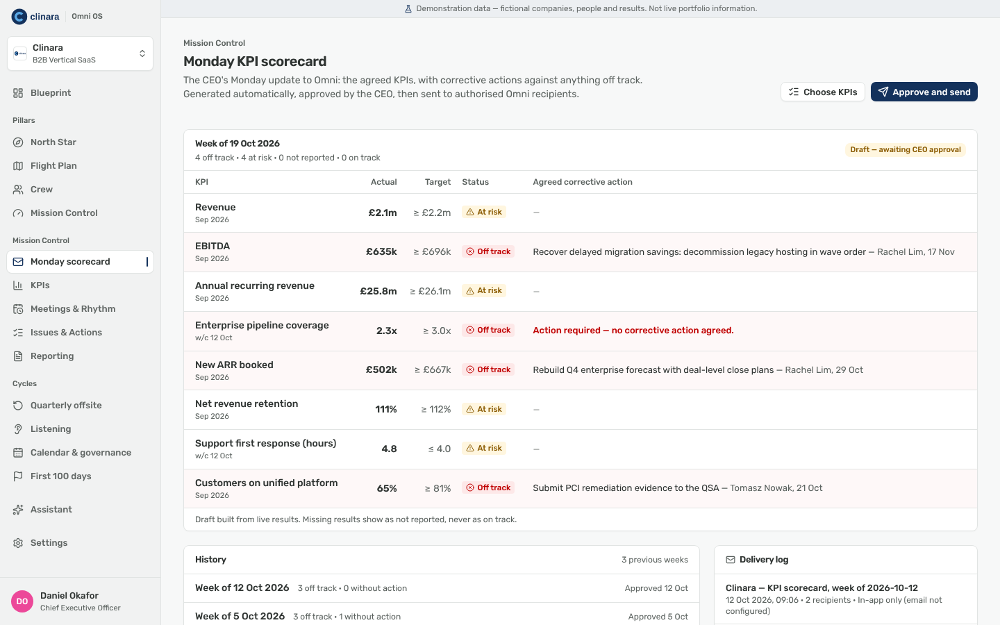 |
| 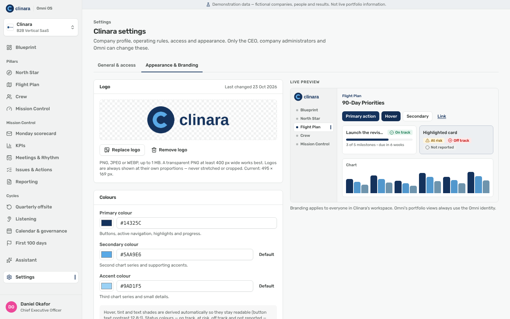 | 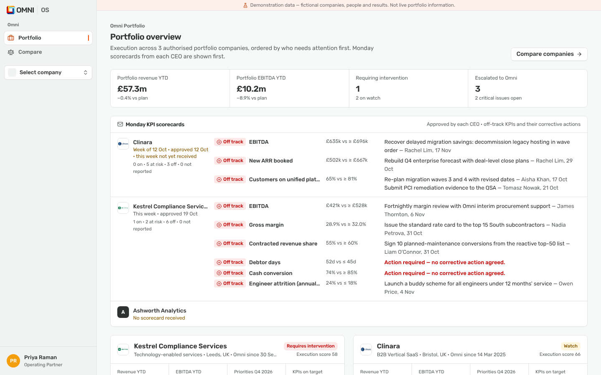 |
| 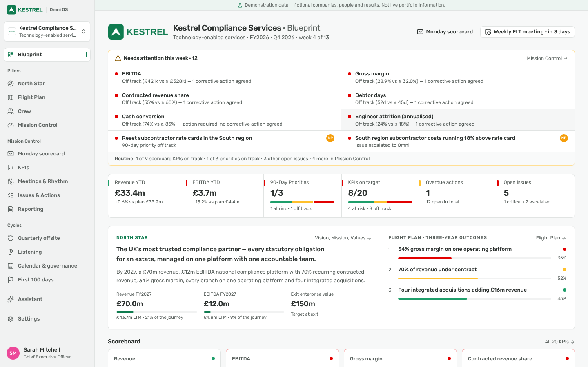 | 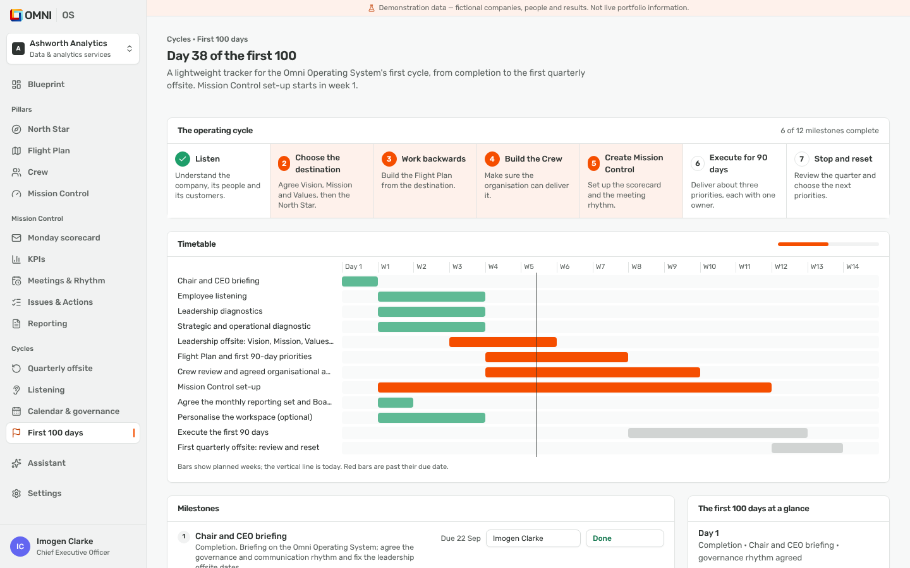 |
| 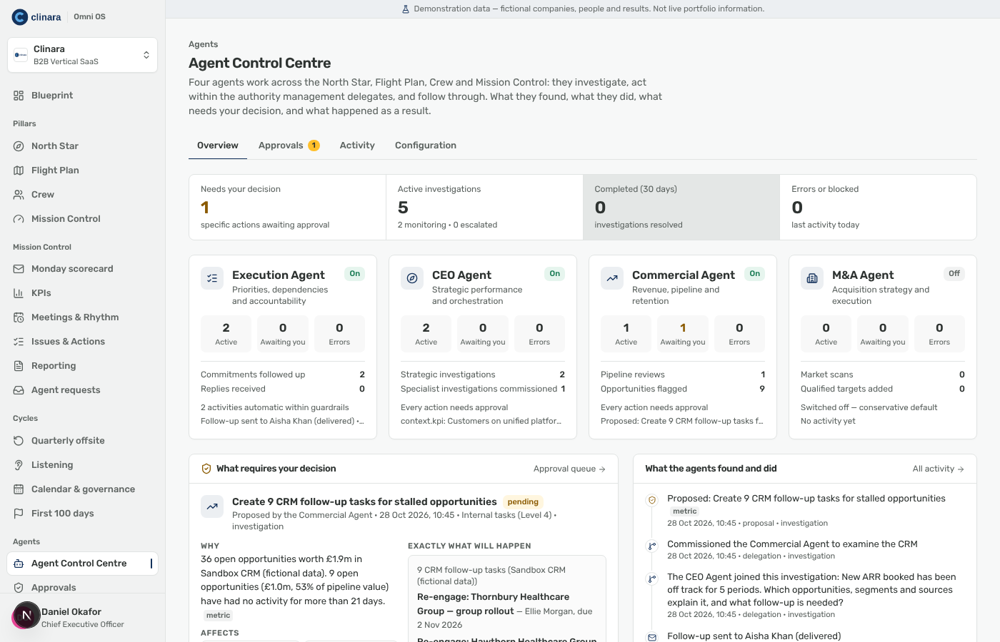 | 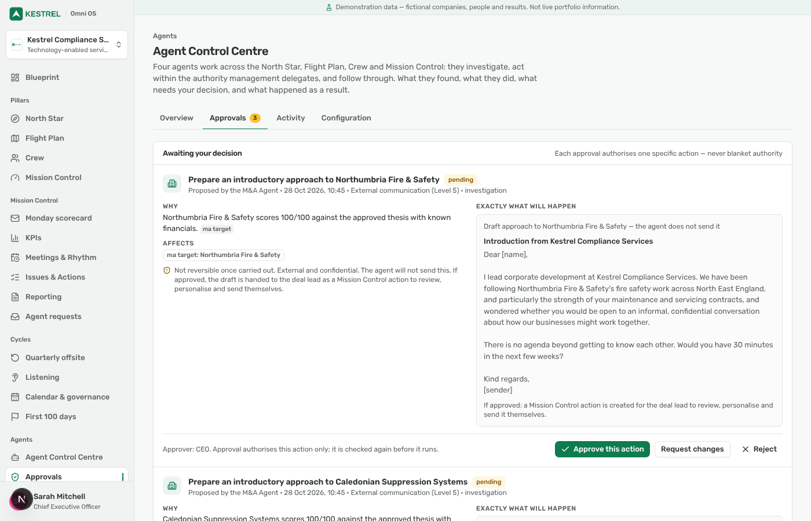 |
| 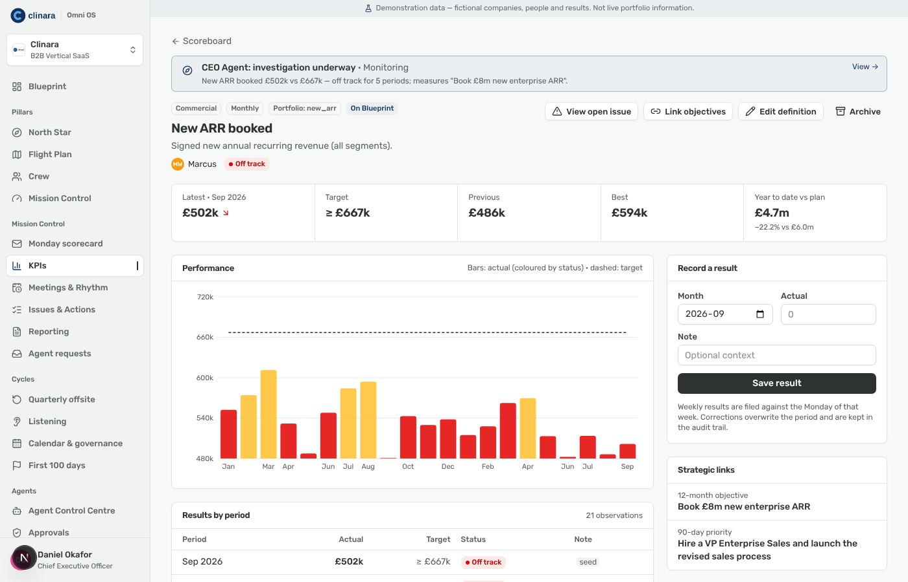 | 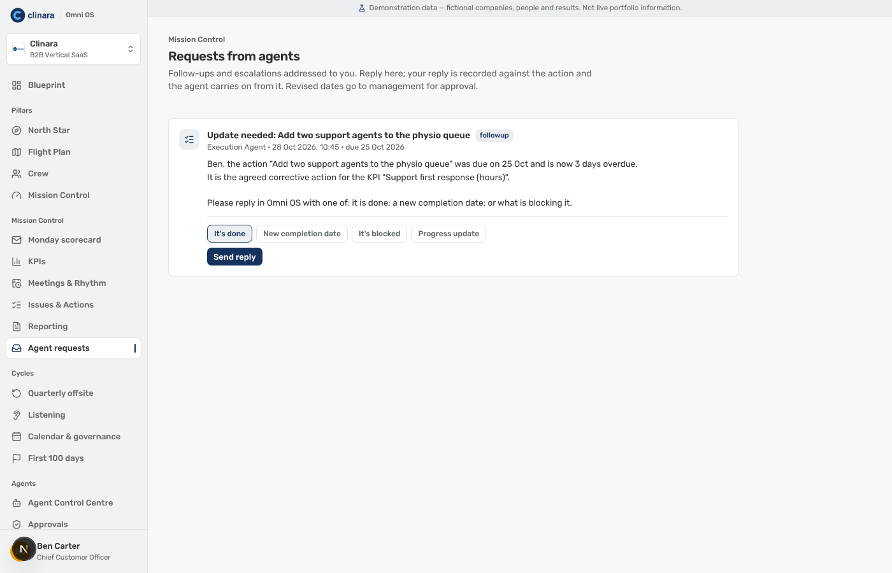 |
| 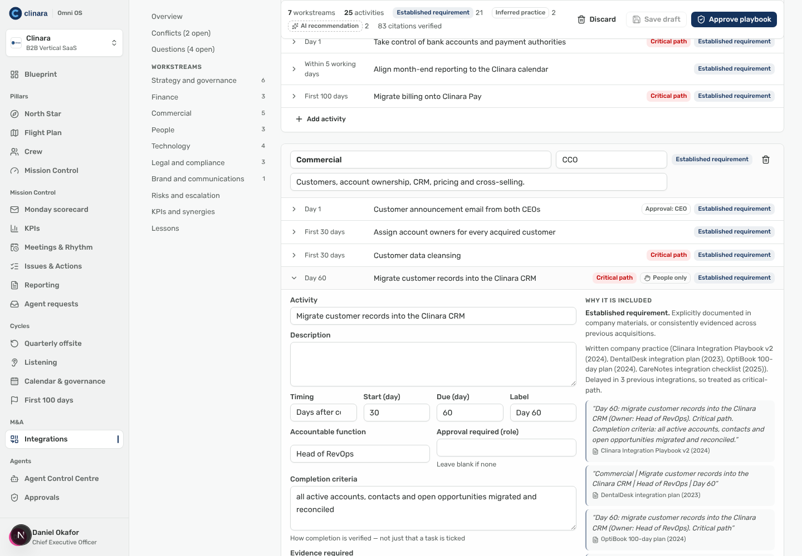 | 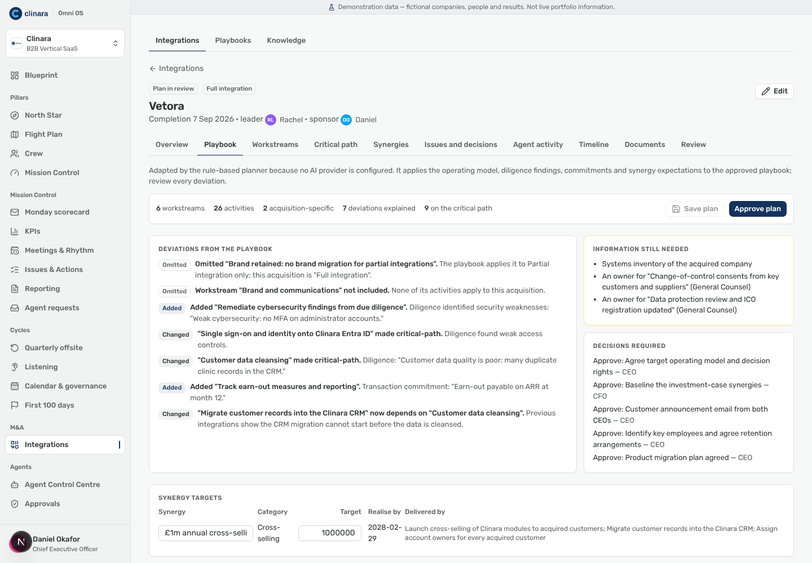 |
| 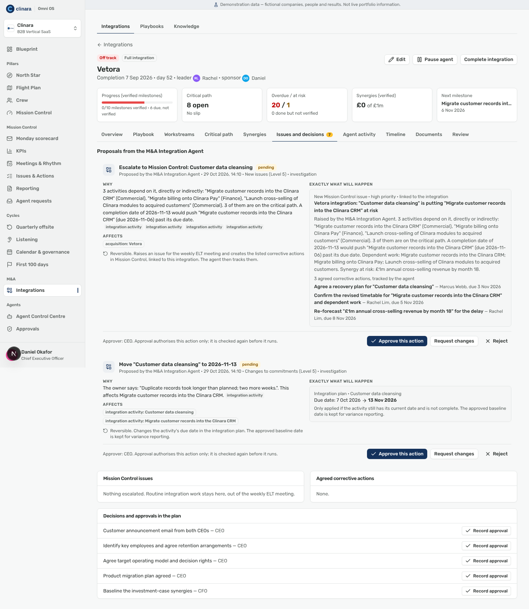 | 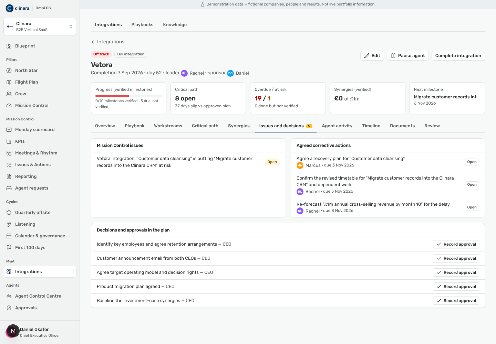 |

## Docs
- `docs/product-spec.md` — what the product does
- `docs/architecture.md` — routes, data model, security model
- `docs/agents.md` — the agentic execution layer: agents, authority, engine, connections
- `docs/integration.md` — the M&A Integration Agent: knowledge, playbooks, plans, execution, synergies, learning
- `docs/implementation-plan.md` — milestones and status
- `docs/decisions.md` — decision log and known limitations
